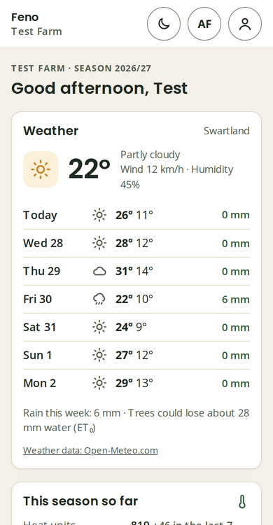
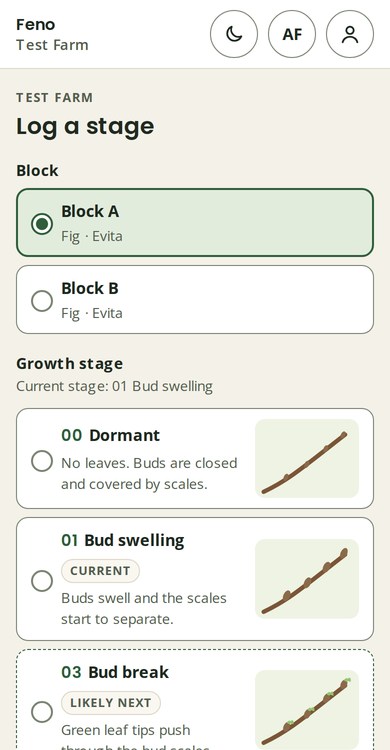
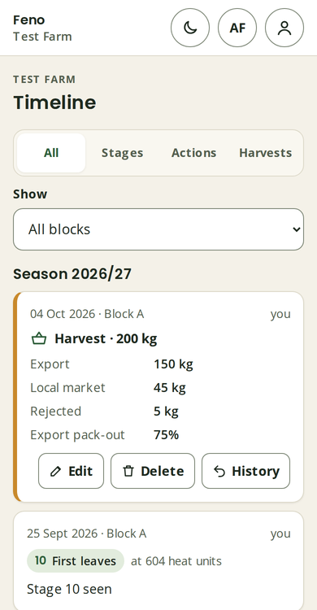
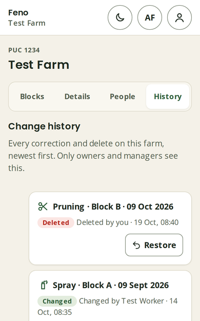
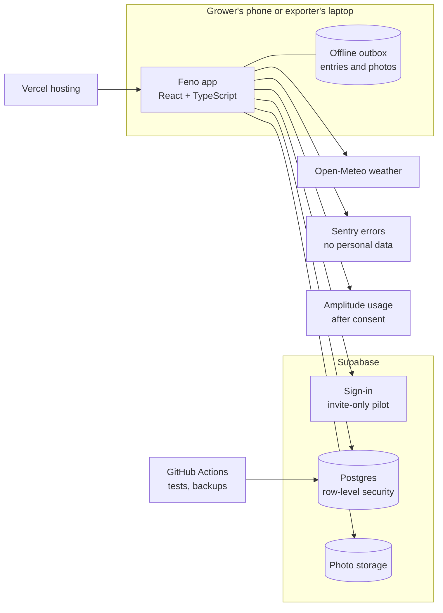

# Feno — a season diary for fig and pomegranate growers

**Product owner:** Belinda Kennedy · [Portfolio](https://inzicht-analytics.github.io/) · [LinkedIn](https://www.linkedin.com/in/belinda-kennedy-analyst/)

Feno is a mobile app that lets fig and pomegranate growers in the Western Cape log their season, block by block, offline in the orchard, in English and Afrikaans. Its exporter module, **Feno Ops**, gives an export company a harvest forecast built from what growers log, so buyers and shipping are ready before picking.

I found the problem, wrote the requirements, own the backlog and ship it, with Claude as my daily build partner. The code is private because it runs a live pilot with real farms; this page shows how the product is run.

| | |
| --- | --- |
| Status | Pilot with growers and a first exporter, Western Cape |
| Backlog | 75 issues closed, 99 open, 7 dated milestones |
| Delivery | 105 pull requests merged, 46 database migrations |
| Quality | 326 unit tests, 255 browser tests and 28 database rule suites, run on every change |

  
  
  
  

Screenshots use made-up test data.

## The problem

Figs and pomegranates are "lesser-known" crops in South Africa. There is no shared recipe for feeding, irrigating, pruning or spraying them, so growers rely on chemical sales reps for advice. I interviewed fig growers in Porterville and Piket-Bo-Berg. They lacked season data for their own location, wanted to capture it stage by stage, and several said they would pay for a tool that did it.

## What I own

- **Discovery:** grower interviews, sponsor meetings, and the problem statement above.
- **Requirements:** user stories with acceptance criteria, the data model, and the growth-stage list (BBCH scale).
- **Backlog and roadmap:** GitHub Issues and Projects, labelled as feature, enhancement, defect, tech debt, security and stability, with dated milestones.
- **Privacy and governance:** POPIA consent, the privacy policy in English and Afrikaans, and a data agreement for each exporter before any grower shares.
- **Adoption:** a pilot welcome guide in both languages and a guided install step, after growers told me they did not know apps could be installed from a browser.

## Feedback in, decisions out

Pilot feedback goes into the backlog as a problem statement, and comes back to growers as a decision with a reason.

| What growers or the exporter said | What I decided |
| --- | --- |
| They didn't know an app could be installed from Chrome | A guided install step on first run, per phone and browser |
| They wanted to know who can see their farm | Farm → People lists everyone who can see the records; other growers only ever see area averages from 3+ farms with 3+ owners |
| Pollination doesn't fit a growth stage | Logged as an activity with phases, not a stage |
| The exporter needs volumes before harvest | A harvest forecast from the diary, labelled as Feno's until the grower confirms it |
| Growers must stay in control of what is shared | Each kind of record is its own tick, all off until the owner ticks it |
| The Log menu was hard to scan in the orchard | Two drawers, *Pre-harvest* and *Harvest*, the right one opens first for the time of year |

## How it is built

Three rules shape every change:

1. **The grower owns the record.** They can export everything as Excel or CSV, and delete a farm or account at any time.
2. **The diary works offline first.** Entries save on the phone and send exactly once when signal returns.
3. **Feno shows evidence, never advice.** It reminds and compares; it never recommends a spray.

Privacy lives in the database, not only the screens: every table has row-level security, exporters only read what the owner shares, and every change is kept in a history that owners can restore from.

## How I work with AI

- **Claude as build partner.** I write the requirements, rules and acceptance criteria; Claude writes code against them; the tests decide what ships.
- **Written rules for the AI.** A project rulebook sets the standards every change must meet: plain language, privacy and tests.
- **Connected tools.** Through MCP connectors I check deploys, errors, data and usage in Vercel, Supabase, Sentry and Amplitude from one conversation.
- **Custom skills.** I designed 10 Claude skills, including a product-manager partner and a full-stack developer, that I use every week.

## Roadmap

| Milestone | Due |
| --- | --- |
| Ready for pilot | 13 Nov 2026 |
| Feno Ops | 30 Nov 2026 |
| Pilot | 18 Dec 2026 |
| Launch | 26 Jan 2027 |
| 2027 harvest | 28 May 2027 |
| 2027/28 season ready | 31 Aug 2027 |

Next up: automatic weather and heat units per farm, stage and harvest forecasts, and a first pest alert.

---

Happy to walk through the product, backlog or code in an interview: belinda.innovate@gmail.com
